<div align="center">



<a href="https://git.io/typing-svg">
  
</a>

<br/>

<a href="mailto:caudanabautista0021@gmail.com"></a>
<a href="https://github.com/BauDev0"></a>


</div>

<br/>



## `$ cat about.md`

Soy **estudiante de Ingeniería Informática** y desarrollador orientado al **backend**: diseño APIs, modelo bases de datos y escribo herramientas de línea de comandos que automatizan trabajo real. Pienso cada sistema con **mentalidad de seguridad** — primero entender cómo se rompe, después construirlo para que no lo haga.

Soy autodidacta por naturaleza: lo que no veo en la facultad lo aprendo por mi cuenta, lo practico y lo subo acá.

```go
type Engineer struct {
    Name      string
    Role      []string
    Focus     []string
    Mindset   string
    Workflow  string
}

var bautista = Engineer{
    Name:     "Bautista Caudana",
    Role:     []string{"Backend Developer", "Security Enthusiast"},
    Focus:    []string{"APIs", "SQL / NoSQL", "Ethical Hacking", "Linux", "Redes"},
    Mindset:  "Resolver problemas reales con sistemas que escalen",
    Workflow: "Git + Scrum · código limpio · tests · documentación",
}
```

<br/>

## `$ ls ~/stack`

<table>
  <tr>
    <td align="center" width="140"><b>Lenguajes</b></td>
    <td></td>
  </tr>
  <tr>
    <td align="center"><b>Backend & .NET</b></td>
    <td></td>
  </tr>
  <tr>
    <td align="center"><b>Bases de datos</b></td>
    <td> &nbsp;</td>
  </tr>
  <tr>
    <td align="center"><b>Seguridad & SO</b></td>
    <td></td>
  </tr>
  <tr>
    <td align="center"><b>DevOps & equipo</b></td>
    <td></td>
  </tr>
</table>

<br/>

## `$ ./capabilities --list`

| 🧩 Área | Qué hago |
|---|---|
| **Backend & APIs** | Diseño de APIs, arquitectura en capas, POO, serialización, testing y CLIs con .NET y Go. |
| **Bases de datos** | Modelado relacional, normalización y consultas en MySQL y SQL Server; nociones de NoSQL. |
| **Ciberseguridad** *(en formación)* | Ethical hacking, OWASP Top 10, análisis de redes y hardening de sistemas Linux. |
| **Ingeniería** | Git flow, metodologías ágiles (Scrum), código mantenible y documentado. |

<br/>

## `$ git log --projects --featured`

<table>
  <tr>
    <td width="50%" valign="top">
      <h3>🛠️ <a href="https://github.com/BauDev0/UcseCLI">UcseCLI</a></h3>
      <p>Herramienta de línea de comandos para el ecosistema <b>.NET 10</b> que <b>automatiza la estructuración de proyectos</b>: genera la arquitectura base en segundos y estandariza el trabajo del equipo.</p>
      
      
      
    </td>
    <td width="50%" valign="top">
      <h3>⚔️ <a href="https://github.com/BauDev0/Eternal-Realms-CLI-">Eternal Realms CLI</a></h3>
      <p>RPG por consola con foco en <b>arquitectura orientada a objetos</b>, manejo de estado y lógica de juego desacoplada. Proyecto de diseño de software a largo plazo.</p>
      
      
      
    </td>
  </tr>
  <tr>
    <td width="50%" valign="top">
      <h3>👾 <a href="https://github.com/BauDev0/Galaxian">Galaxian</a></h3>
      <p>Juego arcade de naves espaciales desarrollado como proyecto final de <b>Algoritmos y Programación</b>: lógica en <b>Go</b> con interfaz web en HTML y CSS.</p>
      
      
      
    </td>
    <td width="50%" valign="top">
      <h3>🧪 <a href="https://github.com/BauDev0/POO_3_Serializacion">POO · Serialización</a></h3>
      <p>Práctica de <b>programación orientada a objetos</b> integrando <b>testing unitario</b> y <b>serialización</b> de datos: persistencia, contratos y código verificable.</p>
      
      
      
    </td>
  </tr>
</table>

<br/>

## `$ cat roadmap.log`

```diff
+ [████████████] Fundamentos de programación, POO y estructuras de datos
+ [████████░░░░] Backend con .NET y Go · diseño de APIs REST
+ [███████░░░░░] Bases de datos relacionales · optimización de consultas
! [█████░░░░░░░] Ciberseguridad ofensiva · CTFs · OWASP Top 10
! [████░░░░░░░░] Redes, Linux y hardening de servidores
# [██░░░░░░░░░░] Docker, CI/CD y despliegue en la nube
```

<br/>

## `$ gh stats --user BauDev0`

<div align="center">


</div>

<br/>

## `$ ./contact.sh`

<div align="center">

**¿Tenés un proyecto, una pasantía o un puesto junior en backend o seguridad?**<br/>
Respondo rápido y me sumo con ganas de aprender y aportar desde el primer día.

<br/>

<a href="mailto:caudanabautista0021@gmail.com"></a>

<br/><br/>


</div>
